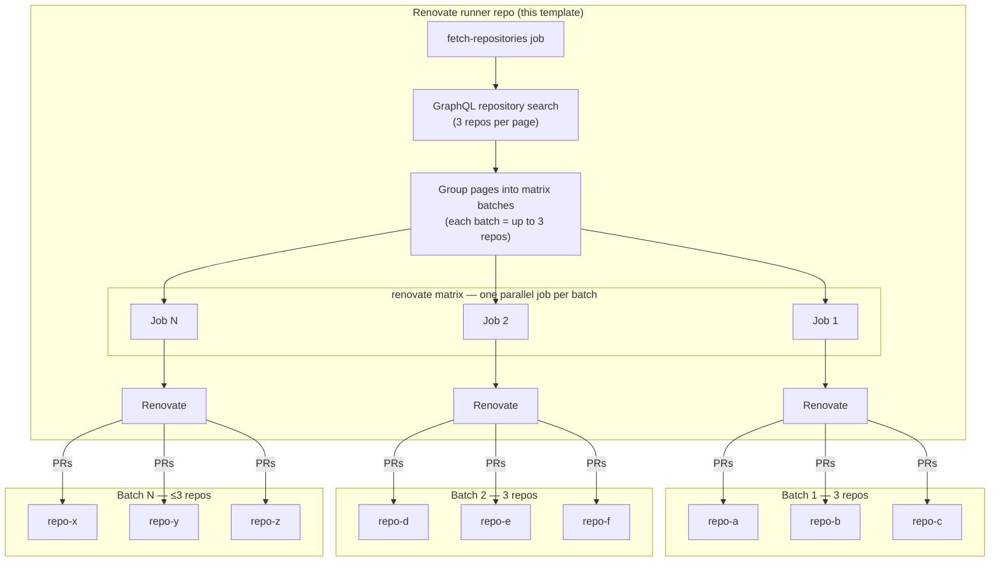

# Self-Hosted Renovate Runner for GitHub Actions

GitHub template for running a self-hosted [Renovate](https://docs.renovatebot.com/) bot on GitHub Actions. One runner repository discovers target repositories, batches them, and runs Renovate in parallel using a GitHub App.

This template ships with:

- A two-job workflow based on [WyriHaximus/renovate-runner](https://github.com/WyriHaximus/renovate-runner) that discovers repositories via the GitHub GraphQL API, groups them, and runs [WyriHaximus/github-action-renovatebot](https://github.com/WyriHaximus/github-action-renovatebot) in a matrix (Composer plugins/scripts, post-upgrade `git add`, Docker socket access, and related defaults)
- A starter [`.github/renovate.json`](.github/renovate.json) extending the [`github-action` preset](https://github.com/WyriHaximus/renovate-config/blob/main/github-action.json) from [WyriHaximus/renovate-config](https://github.com/WyriHaximus/renovate-config)

For background on why this setup exists, see [Unlock Composer Plugins by Self Hosting Renovate](https://blog.wyrihaximus.net/2025/10/unlock-composer-plugins-by-self-hosting-renovate/).

## How it works



1. The **fetch-repositories** job queries GitHub for repositories that match a search string (public, non-fork, non-archived repos owned by the runner account by default).
2. Matching repositories are grouped in batches of three for the matrix.
3. Each **renovate** matrix job mints a scoped installation token for its batch and runs Renovate against those repositories.

The runner repository itself does not need to contain the code of the repositories Renovate manages.

## Prerequisites

- A GitHub user or organization account
- Permission to create a GitHub App and install it on the account whose repositories you want Renovate to manage
- A dedicated repository created from this template (for example `my-org/renovate-runner`)

## Quick start

### 1. Create the runner repository

1. Click **Use this template** on GitHub (or create a new repository from this template).
2. Name it something clear, for example `renovate-runner`.
3. Place it under the same user or organization whose repositories Renovate should manage.

### 2. Create a GitHub App

Create a new GitHub App under the same user or organization that will own the runner repository:

1. Go to **Settings → Developer settings → GitHub Apps → New GitHub App**.
2. Set a name (for example `My Renovate Bot`) and homepage.
3. Disable **Webhook → Active** (Renovate does not need webhooks for this setup).
4. Set **Repository permissions**:

   | Permission        | Access        | Why                                      |
   |-------------------|---------------|------------------------------------------|
   | Contents          | Read & write  | Read manifests, push update branches     |
   | Issues            | Read & write  | Dependency Dashboard                   |
   | Pull requests     | Read & write  | Open and update PRs                      |
   | Workflows         | Read & write  | Update GitHub Actions workflow files     |
   | Metadata          | Read          | Required baseline access                 |

5. Under **Where can this GitHub App be installed?**, choose **Only on this account** (recommended) or **Any account**, depending on your needs.
6. Create the app, then:
   - Note the **App ID** (used as `RENOVATE_BOT_CLIENT_ID`).
   - Generate and download a **private key** (used as `RENOVATE_BOT_PRIVATE_KEY`).
7. Install the app on your user or organization and grant it access to every repository Renovate should manage (or **All repositories**).

### 3. Add repository secrets

In the **runner repository**, open **Settings → Secrets and variables → Actions** and add:

| Secret                     | Description |
|----------------------------|-------------|
| `RENOVATE_BOT_CLIENT_ID`   | GitHub App ID |
| `RENOVATE_BOT_PRIVATE_KEY` | Full contents of the downloaded `.pem` private key |

No manual repository list secret is required. The workflow discovers repositories automatically (see [Repository discovery](#repository-discovery)).

### 4. Enable GitHub Actions

Ensure Actions are enabled on the runner repository. Push to `main` (or wait for the next scheduled run) to verify the workflow succeeds.

### 5. Onboard target repositories

For each repository Renovate should manage:

1. Grant the GitHub App access to that repository (during install, or later under **Settings → GitHub Apps**).
2. Ensure the repository matches the [search query](#repository-discovery) used by the workflow.
3. Merge Renovate’s onboarding PR when it appears (or add your own `.github/renovate.json` first).

Renovate uses the onboarding config from [WyriHaximus/github-action-renovatebot](https://github.com/WyriHaximus/github-action-renovatebot) and writes config to `.github/renovate.json` unless you already provide one.

## Repository discovery

The workflow in [`.github/workflows/renovate.yaml`](.github/workflows/renovate.yaml) is based on [WyriHaximus/renovate-runner](https://github.com/WyriHaximus/renovate-runner/blob/main/.github/workflows/renovate.yaml).

By default, the GraphQL search query is:

```text
owner:<runner-owner> is:public fork:false archived:false sort:updated-desc
```

`<runner-owner>` is `${{ github.repository_owner }}` (the user or organization that owns the runner repository).

### Custom search query

To include private repositories or narrow the set of repositories, set a repository **variable** (not a secret):

| Variable | Description |
|----------|-------------|
| `RENOVATE_REPOSITORY_SEARCH_QUERY` | GitHub repository search query passed to the GraphQL API |

Examples:

```text
org:my-org fork:false archived:false sort:updated-desc
```

```text
owner:my-user fork:false archived:false sort:updated-desc
```

See [GitHub search syntax for repositories](https://docs.github.com/en/search-github/searching-on-github/searching-for-repositories) for available qualifiers.

The GitHub App must still be installed on every repository Renovate should update. Discovery only decides which repositories each run considers.

### Batching

Repositories are fetched in pages of three and each page becomes one matrix job. Matrix jobs run in parallel (`fail-fast: false`), so large accounts spread work across multiple concurrent Renovate runs while keeping each installation token scoped to a small batch.

## Workflow behaviour

The default workflow runs when:

| Trigger | Purpose |
|---------|---------|
| Cron (weekdays, hourly 08:00–22:00 UTC plus 06:00 UTC) | Regular dependency scans during waking hours |
| Cron (weekends, hourly 12:00–23:00 UTC plus 05:00 UTC) | Lighter weekend schedule |
| Push to `main` | Pick up workflow or action updates immediately |
| Issue edited | Re-run when the Dependency Dashboard rebase checkbox is used |

Only one workflow run is active at a time (`concurrency: renovate`, `cancel-in-progress: true`).

## Configuring Renovate

### Runner repository config

[`.github/renovate.json`](.github/renovate.json) in the runner repo mainly keeps Renovate’s own dependencies (the workflow and action pins) up to date:

```json
{
  "$schema": "https://docs.renovatebot.com/renovate-schema.json",
  "extends": [
    "github>WyriHaximus/renovate-config:github-action"
  ]
}
```

### Target repository config

Each managed repository should have its own `.github/renovate.json`. Common presets from [WyriHaximus/renovate-config](https://github.com/WyriHaximus/renovate-config):

| Preset | Use for |
|--------|---------|
| `github>WyriHaximus/renovate-config:php-package` | Public PHP libraries |
| `github>WyriHaximus/renovate-config:php-project` | Private PHP projects (limits PR volume) |
| `github>WyriHaximus/renovate-config:default` | General-purpose setup |

Example for a PHP application:

```json
{
  "$schema": "https://docs.renovatebot.com/renovate-schema.json",
  "extends": [
    "github>WyriHaximus/renovate-config:php-project"
  ]
}
```

See the [renovate-config README](https://github.com/WyriHaximus/renovate-config#usage) for all presets and package rules.

## Adding or removing repositories

1. **Grant or revoke app access** to the repository under **Settings → GitHub Apps**.
2. **Adjust the search query** if the repository should be included or excluded by discovery rules.
3. Wait for the next scheduled run, push to `main`, or tick a checkbox on the Dependency Dashboard to trigger a run.

Removing app access is enough to stop Renovate from updating a repository, even if it still matches the search query.

## Optional: debug runs

For troubleshooting, add a manually triggered workflow or temporarily set `logLevel: debug` on the Renovate step:

```yaml
- name: Renovate
  uses: WyriHaximus/github-action-renovatebot@v0.16.0
  with:
    renovateAppToken: ${{ steps.app-token.outputs.token }}
    logLevel: debug
```

Debug logging uses JSON format and is verbose; switch back to `info` when finished.

## Optional: private registry credentials

If Renovate must authenticate to private registries (Docker Hub, Packagist, and so on), pass host rules into the action:

```yaml
- name: Renovate
  uses: WyriHaximus/github-action-renovatebot@v0.16.0
  with:
    renovateAppToken: ${{ steps.app-token.outputs.token }}
    hostRules: ${{ secrets.RENOVATE_HOST_RULES }}
```

Store `RENOVATE_HOST_RULES` as a JSON array, for example:

```json
[
  {
    "matchHost": "docker.io",
    "username": "my-user",
    "password": "my-token"
  }
]
```

## Related projects

| Repository | Role |
|------------|------|
| [WyriHaximus/renovate-runner](https://github.com/WyriHaximus/renovate-runner) | Reference runner implementation this template is based on |
| [WyriHaximus/github-action-renovatebot](https://github.com/WyriHaximus/github-action-renovatebot) | Composite action wrapping `renovatebot/github-action` with this setup’s defaults |
| [WyriHaximus/renovate-config](https://github.com/WyriHaximus/renovate-config) | Shared Renovate presets (scheduling, PHP rules, GitHub Actions pinning) |

## License

MIT © [Cees-Jan Kiewiet](https://wyrihaximus.net/) — see [LICENSE](LICENSE).
